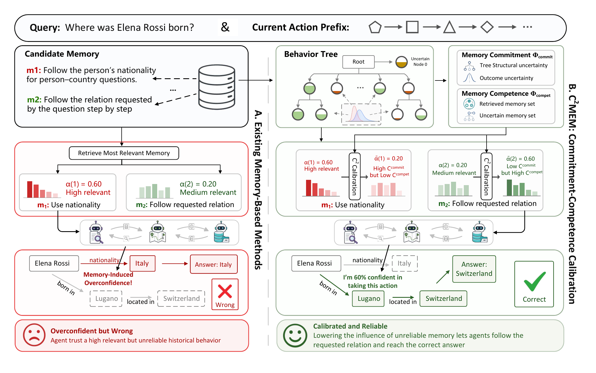

# C2Mem: Commitment–Competence Calibration for Self-Evolving Multi-Agent Systems

<p align="center">
  
</p>

## 👋 Introduction

This repository implements **C2Mem**, the method introduced in *Beware of
Memory-Induced Overconfidence: Commitment–Competence Calibration for
Self-Evolving Multi-Agent Systems*. C2Mem mitigates memory-induced
overconfidence by jointly modeling memory commitment and competence, calibrating
retrieved behavior-tree memories against an unknown node before injection, and
updating Beta posteriors from task outcomes to evolve memory online. The
implementation focuses on the proposed C2Mem method.

## 🌎 Setup

```bash
conda create -n c2mem python=3.11 -y
conda activate c2mem
python -m pip install -r requirements.txt
```

Copy the environment template and fill in the providers you use:

```bash
cp .env.example .env
```

```dotenv
# OpenAI-compatible chat endpoint used by the MAS and C2Mem
OPENAI_API_BASE=your-chat-base-url
OPENAI_API_KEY=your-chat-api-key
OPENAI_MODEL_NAME=your-chat-model

# OpenAI-compatible embedding endpoint used by C2Mem
EMBEDDING_API_BASE=your-embedding-base-url
EMBEDDING_API_KEY=your-embedding-api-key
EMBEDDING_MODEL_NAME=your-embedding-model

# Base URL of your own Wikipedia retrieval deployment
WIKI_SERVICE_URL=your-wikipedia-service-base-url
WIKI_SERVICE_TIMEOUT_SECONDS=120

```

Both model connections require an explicit base URL and API key. Defaults and
optional named profiles can be configured in
[`src/configs/configs.yaml`](src/configs/configs.yaml). The embedding endpoint is
used for C2Mem behavior retrieval and splitting; Wikipedia query embeddings are
generated inside the separately deployed Wikipedia service.

## 🚀 Quick Start

### 🌳 Dataset Setup

Create the data directories:

```bash
mkdir -p data/fever data/hotpotqa data/wikipedia
```

Download the files below and save them at the corresponding paths:

- [FEVER paper development split](https://fever.ai/download/fever/paper_dev.jsonl)
  → `data/fever/fever_dev.jsonl`
- [HotpotQA distractor development split](https://curtis.ml.cmu.edu/datasets/hotpot/hotpot_dev_distractor_v1.json)
  → `data/hotpotqa/hotpot_dev_distractor_v1.json`
- [HotpotQA Wikipedia abstracts](https://nlp.stanford.edu/projects/hotpotqa/enwiki-20171001-pages-meta-current-withlinks-abstracts.tar.bz2)
  → `data/wikipedia/enwiki-20171001-pages-meta-current-withlinks-abstracts.tar.bz2`

The resulting directory structure is:

```text
data/
├── fever/
│   └── fever_dev.jsonl
├── hotpotqa/
│   └── hotpot_dev_distractor_v1.json
└── wikipedia/
    └── enwiki-20171001-pages-meta-current-withlinks-abstracts.tar.bz2
```

### 📚 Wikipedia Retrieval Service

FEVER and HotpotQA access Wikipedia through the external `wikipedia-service`
for the actions `Search[query]` and `Lookup[title]`.

#### 1. Build the Chroma index

Test the pipeline with a small batch:

```bash
python -m src.datasets.hotpotqa.abstracts_ingest \
  --archive data/wikipedia/enwiki-20171001-pages-meta-current-withlinks-abstracts.tar.bz2 \
  --limit 1000 --batch-size 5000
```

Then build the complete index:

```bash
python -m src.datasets.hotpotqa.abstracts_ingest \
  --archive data/wikipedia/enwiki-20171001-pages-meta-current-withlinks-abstracts.tar.bz2 \
  --limit 0 --batch-size 5000
```

The index is written to `.db/chroma/` as collection `wiki_abstracts`. Progress
is persisted in `temp/wiki_abstracts_ingest_ckpt.json`, so rerunning the same
command resumes an interrupted ingest.

#### 2. Deploy the service

The deployable HTTP service is included under [`wikipedia/`](wikipedia/). It is
kept separate from the experiment process so that the Chroma index stays loaded
across tasks.

Create its environment file and configure the query embedding connection. The
base URL, key, and model must describe the same embedding model used to build
the index:

```bash
cd wikipedia
cp .env.example .env
```

```dotenv
WIKI_SERVICE_EMBED_MODE=api
EMBEDDING_API_BASE=your-embedding-base-url
EMBEDDING_API_KEY=your-embedding-api-key
EMBEDDING_MODEL_NAME=your-embedding-model

WIKI_SERVICE_CHROMA_DIR=../.db/chroma
WIKI_SERVICE_COLLECTION=wiki_abstracts
```

Create an isolated Python environment, install the service dependencies, and
start the server:

```bash
python -m venv .venv
source .venv/bin/activate
python -m pip install -r requirements.txt
set -a
source .env
set +a
uvicorn app.main:app --host "$WIKI_SERVICE_HOST" --port "$WIKI_SERVICE_PORT"
```

The deployment must provide:

- `GET /health`
- `GET /ready`
- `POST /search` with `{"query": str, "top_k": int}`
- `POST /lookup` with `{"title": str}`

Set `WIKI_SERVICE_URL` to the deployed base URL and verify it before running an
experiment:

```bash
curl "$WIKI_SERVICE_URL/health"
curl "$WIKI_SERVICE_URL/ready"
curl -X POST "$WIKI_SERVICE_URL/search" \
  -H 'Content-Type: application/json' \
  -d '{"query":"Albert Einstein","top_k":3}'
```

Complete standalone deployment, direct Python startup, index mounting, and API
instructions are in [`wikipedia/README.md`](wikipedia/README.md). The client
contract is documented in
[`docs/references/wikipedia-service.md`](docs/references/wikipedia-service.md).

### 🔎 Choices Overview

- **Online memory:** `c2mem`
- **MAS topologies:** `AutoGen`, `DyLAN`, `LLM-Debate`, `MacNet`, and
  `Supervisor-Fanout`
- **Memory modes:** `train` updates memory; `test` performs read-only retrieval
  and injection
- **Default retrieval size:** top-2 behavior-tree leaves

C2Mem updates a shared store after every task, so a memory-enabled experiment
must use `--concurrency 1`.

### ▶️ How to Run

#### Option 1: edit `run.py`

Set the values in `CONFIG`, then run:

```bash
python run.py
```

#### Option 2: use the command line

Run five HotpotQA tasks sequentially with C2Mem:

```bash
python -m src.main \
  --dataset hotpotqa \
  --graph dylan \
  --mas-memory-backend c2mem \
  --mas-memory-path .db/c2mem/hotpotqa-dylan \
  --mas-memory-topk 2 \
  --num-tasks 5 \
  --max-steps 8 \
  --concurrency 1
```

Run FEVER with a separate store:

```bash
python -m src.main \
  --dataset fever \
  --graph dylan \
  --mas-memory-backend c2mem \
  --mas-memory-path .db/c2mem/fever-dylan \
  --num-tasks 5 \
  --max-steps 10 \
  --concurrency 1
```

Run selected dataset indices without updating memory:

```bash
python -m src.main \
  --dataset hotpotqa \
  --task-indices 1 7 12 \
  --graph dylan \
  --mas-memory-backend c2mem \
  --mas-memory-path .db/c2mem/hotpotqa-dylan \
  --mode test \
  --concurrency 1
```

## 🧠 C2Mem Workflow

1. Embed the current behavioral execution prefix and retrieve the top behavior
   leaves.
2. Estimate a joint support distribution over the retrieved leaves and unknown
   node `0`.
3. Compute retrieval uncertainty, tree uncertainty, commitment, competence,
   posterior competence risk, and memory-induced overconfidence.
4. Calibrate the support distribution and inject only the resulting behavior
   guidance.
5. Aggregate calibrated weights across the task into exposure `rho` and update
   the Beta posteriors.
6. Insert the new episode into the ordinary leaf with the highest positive task
   exposure; create a new root when no ordinary leaf received positive exposure.
7. Split sufficiently large heterogeneous leaves with deterministic
   farthest-seed bipartition.

The full equations, persisted distributions, tree behavior, and configuration
are documented in [`docs/c2mem.md`](docs/c2mem.md).

## 📁 Outputs

```text
.db/c2mem/<experiment>/
├── records.jsonl   # extracted episodes and insertion exposure
└── state.json      # tree, posteriors, retrieval events, and calibration audits

result/c2mem/
└── run_<timestamp>.jsonl
```

The result JSONL contains the run configuration, one record per task, agent
traces, evaluation metrics, token usage, and a final dataset summary. Temporary
traces and ingest checkpoints remain under `temp/`.

## 🫡 Citation

The manuscript is currently an anonymous submission. Public citation metadata
will be added after release.
